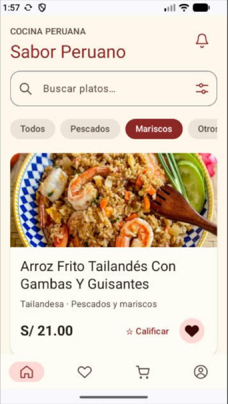
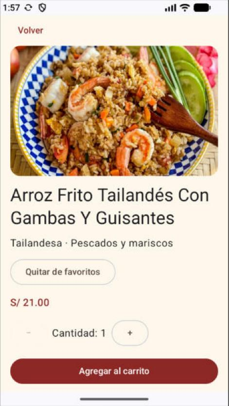
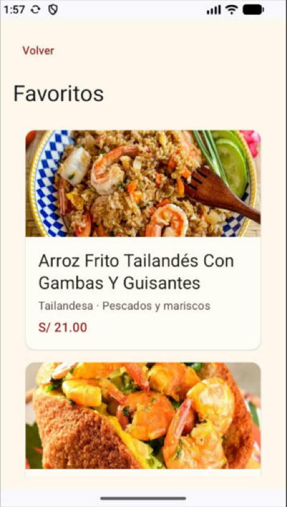
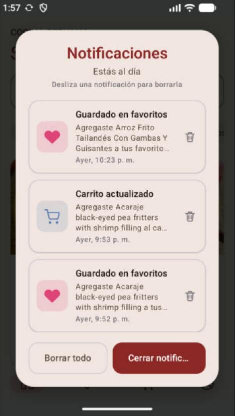
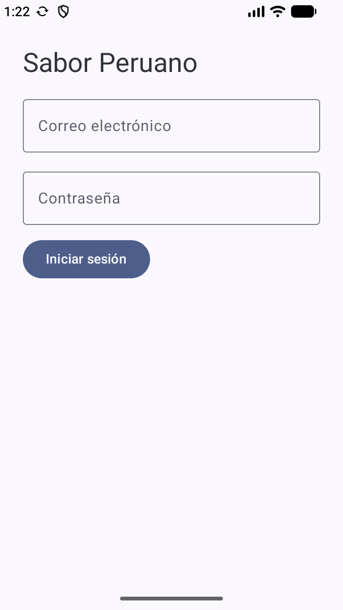
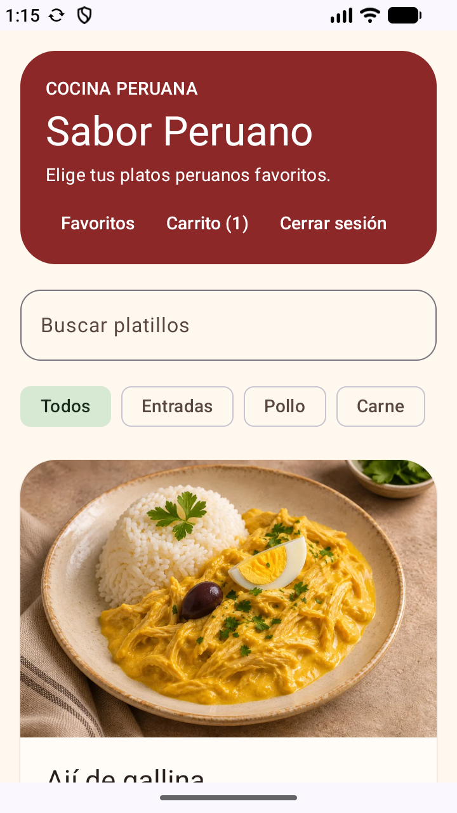
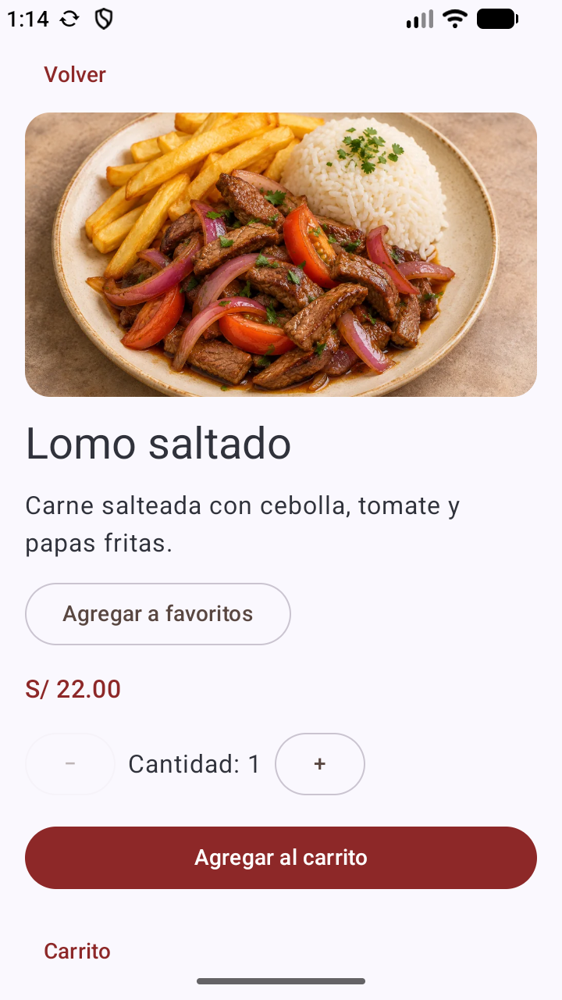
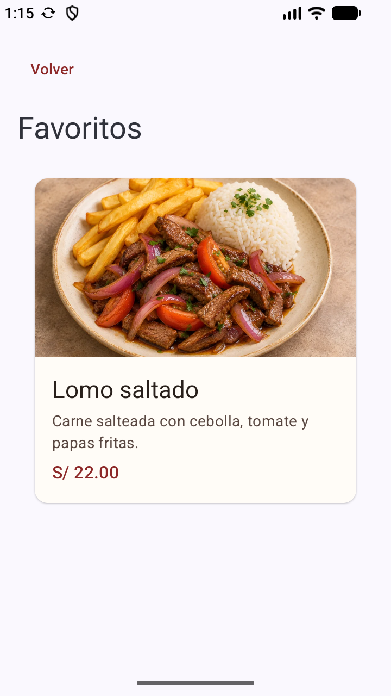
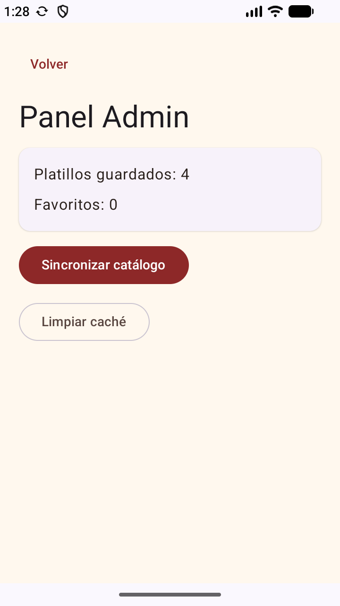
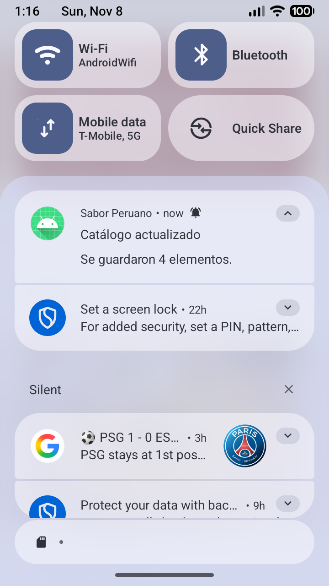

# Sabor Peruano

Aplicación Android de consulta de platos con login de dos roles, catálogo descargado de internet, favoritos guardados en el celular y una notificación local. Laboratorio integrador 11–12 (GLAB-S11) de Programación en Móviles, Tecsup. Proyecto individual.

| Tema | Variante | API base | Lista | Detalle |
| --- | --- | --- | --- | --- |
| Comidas | **Seafood** | `https://www.themealdb.com/api/json/v1/1/` | `/filter.php?c=Seafood` | `/lookup.php?i={id}` |

**Tecnologías:** Kotlin, Jetpack Compose + Material 3, MVVM, Retrofit + kotlinx.serialization, Room, Firebase Authentication + Cloud Firestore, notificaciones locales (canal, permiso `POST_NOTIFICATIONS` y `NotificationCompat`) y ML Kit Translate.

## Cómo funciona

- **Retrofit** consulta TheMealDB (`data/remote/ApiService.kt`). La respuesta viene dentro de `meals`, que puede ser `null` (`RespuestaMeals`).
- **Room** es la fuente única de verdad: la lista siempre sale de la base local, y Retrofit solo la actualiza. Los favoritos se conservan al sincronizar y al cerrar la app, y sin internet se muestra lo guardado con un aviso.
- **Español:** TheMealDB solo tiene datos en inglés. `TraductorMlKit` (`data/traduccion/`) traduce en el celular los nombres, que se guardan ya traducidos en Room, y la preparación del detalle. El modelo de idioma se descarga la primera vez y luego funciona sin conexión.
- **Precios:** TheMealDB no trae precios, así que cada plato recibe un precio fijo de S/ 15 a S/ 25 calculado a partir de su id.
- **Roles:** el rol se lee de Firestore (`usuarios/{uid}`, campo `rol`) después del login. Los dos roles entran al catálogo; solo el admin ve el acceso al panel.

## Compilar y ejecutar

1. Abre el proyecto en Android Studio y sincroniza Gradle.
2. Registra `com.tecsup.saborperuano` en tu proyecto Firebase y coloca `google-services.json` en `app/`. Ese archivo y las credenciales de prueba no se suben a Git.
3. Ejecuta desde la raíz del proyecto:

   ```powershell
   .\gradlew.bat :app:assembleDebug :app:testDebugUnitTest
   ```

4. Elige un emulador **con Google Play** y ejecuta la configuración `app`. El APK queda en `app/build/outputs/apk/debug/app-debug.apk`.

## Cuentas de prueba

1. En **Firebase Authentication**, habilita **Correo electrónico/contraseña** y crea una cuenta admin y una de usuario.
2. En **Cloud Firestore**, crea un documento `usuarios/{uid}` por cuenta usando el UID de Authentication. Asigna el campo `rol` con el valor exacto `admin` o `usuario`, y opcionalmente `nombre`.
3. Para habilitar **Regístrate**, aplica el bloque `usuarios/{uid}` de [firestore.rules](firestore.rules). Permite crear únicamente el perfil propio con rol `usuario`.

## Flujo de demostración

- **Usuario:** busca un plato o filtra por Pescados, Mariscos u Otros. Toca un plato para ver el detalle con su preparación, márcalo como favorito o agrégalo al carrito. La campana muestra los avisos con fecha y hora, y se pueden borrar.
- **Administrador:** entra al catálogo y abre el **panel Admin**, con el total guardado, el total de favoritos, **Sincronizar** y **Limpiar caché**. También puede crear, editar o retirar platos locales.
- **Sin conexión:** con datos guardados, el catálogo sigue disponible con un aviso. Sin datos, aparece el error con **Reintentar**.
- **Pedido:** Carrito → Entrega y pago → Confirmación por WhatsApp. La configuración opcional está en [functions/README.md](functions/README.md).

## Pruebas

- **Unitarias** (`app/src/test`): `ListaViewModelTest` (carga, caché sin conexión y error con reintento, usando un repositorio falso), `MapeoTheMealDbTest`, `CarritoRepositoryTest`, `PedidoWhatsAppTest` y `RegistroViewModelTest`.
- **Instrumentadas** (`app/src/androidTest`): persistencia de favoritos y avisos, menú local y rotación de pantalla.
- **Aceptación:** las 14 pruebas PA-01 a PA-14 de la guía, ejecutadas en el emulador.

## Capturas

Versión actual (`mejora-ia`, TheMealDB en español):

| Catálogo | Detalle | Favoritos | Notificaciones |
| --- | --- | --- | --- |
|  |  |  |  |

Capturas de la fase base (antes de `mejora-ia`):

| Acceso | Catálogo | Detalle |
| --- | --- | --- |
|  |  |  |

| Favoritos | Panel Admin | Notificación |
| --- | --- | --- |
|  |  |  |

## Ramas y versión

- `main`: fase 1, sin IA.
- `mejora-ia`: fase 2, con IA, registrada en [PROMPTS.md](PROMPTS.md). Tiene un Pull Request hacia `main`.
- **v1.0:** Release en GitHub con el APK de depuración adjunto, para probar sin compilar.

## Reparto de tareas

Proyecto individual, autorizado por el docente. Yony Ortiz se encargó de la arquitectura, la integración con TheMealDB, Room y Firebase, la interfaz en Compose, las notificaciones, las pruebas y la documentación.
